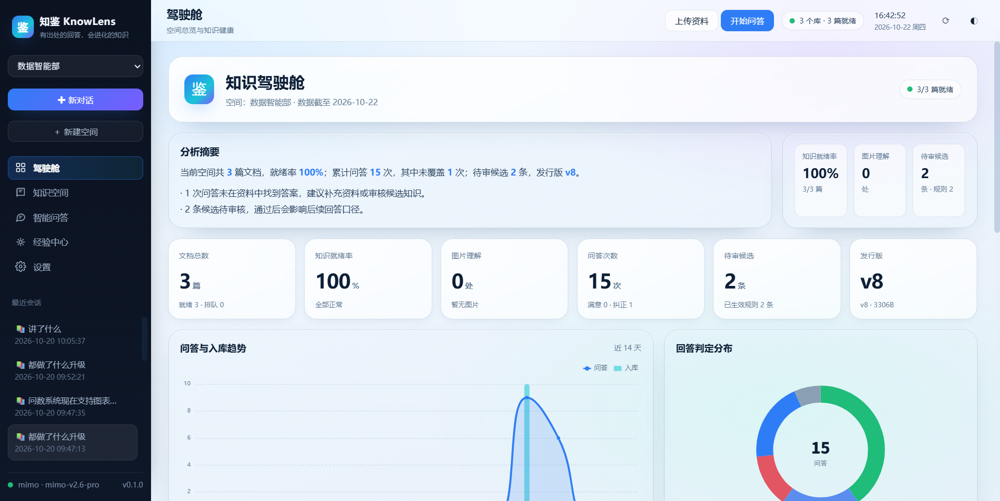
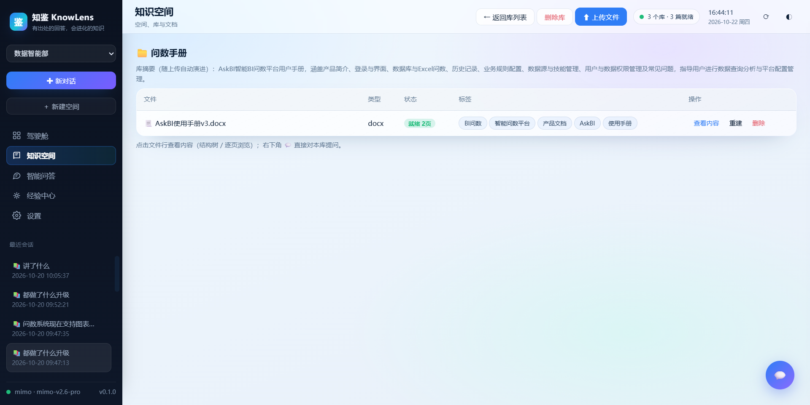
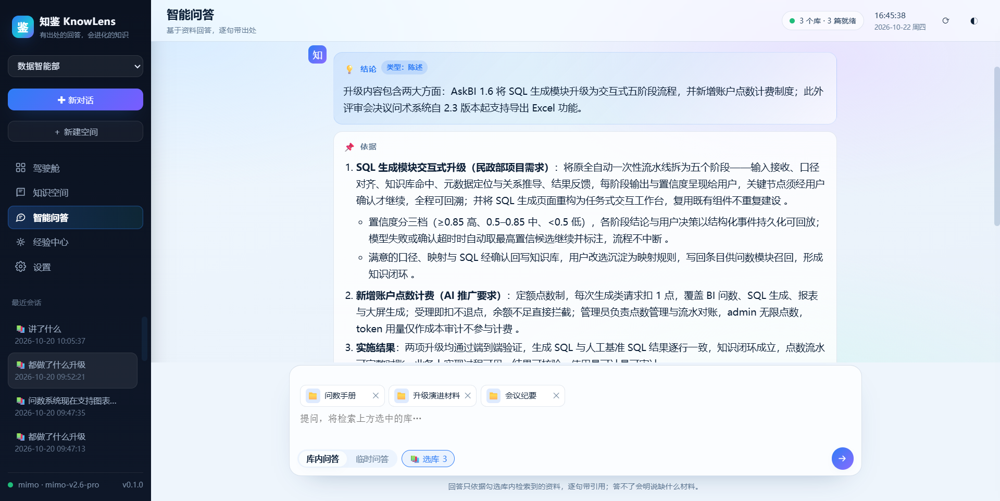
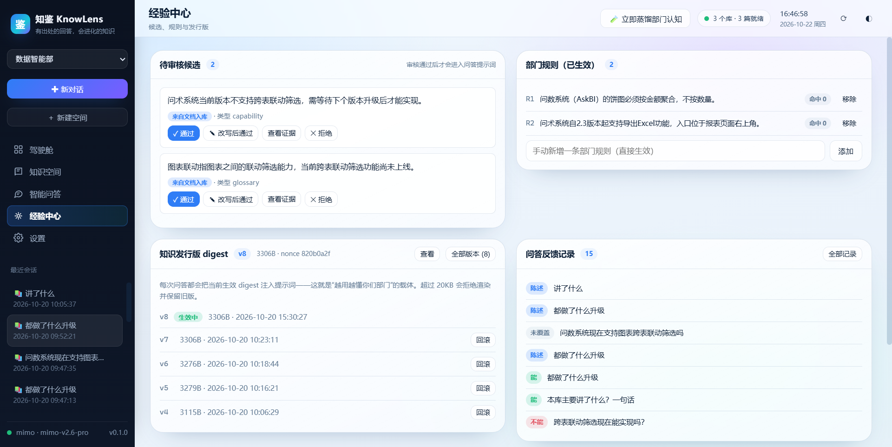

# 知鉴 KnowLens

[English](README.md) | 简体中文

**有出处的回答，会进化的知识。**

部门级知识问答与经验演进智能体：把部门文档、图片、录音变成可检索、可引用、可核验的知识，并通过“候选 → 审核 → 规则 / 画像 → 发行版”的闭环持续进化；提供驾驶舱总览，可选接入 Claude Code 开发经验。


## 截图

| 驾驶舱 | 知识空间 |
|---|---|
|  |  |

| 智能问答 | 经验中心 |
|---|---|
|  |  |

## 功能

| 能力 | 说明 |
|---|---|
| 空间 / 库隔离 | 空间为物理与权限边界；空间内可勾选多库联合检索，跨空间不可联合 |
| 五阶段问答 | 范围路由 → 逐页取证 → 充分性检查 → 四段式回答 → 引用核验 |
| 可核验引用 | 引用精确到文档页码，可展开原文；无效引用自动剔除 |
| 双窗口问答 | 库内问答与临时资料问答；库详情右下角提供单库迷你问答 |
| 多模态入库 | PDF（文本 / 扫描 / 图文混排）、Word、PPT、Excel、Markdown、图片、录音 |
| 图片理解 | 逐张转写文字并生成语义说明，按版面 / 文档顺序写入正文，参与检索与引用 |
| 录音管线 | ffmpeg 归一 → ASR → 带时间码转录 → 结构化会议纪要（议程 / 结论 / 行动项 / 术语） |
| 经验演进 | 候选抽取、三级去重、人工审核、规则 / 画像、空间级发行版、版本化与回滚、证据回放 |
| 驾驶舱 | 知识健康、问答判定、入库趋势、库健康、风险待办、模型调用量 |
| Claude Code 接入（可选） | 导入开发会话提炼经验；把发行版注入项目 SessionStart hook，默认关闭 |

## 架构

```
浏览器（原生 JS + ECharts）
   │ REST / SSE
FastAPI 服务
   ├─ 问答管线：路由 → PageIndex 工具循环 → 引用核验
   ├─ 入库管线：PDF / Office / 图片 / 录音 → 层级树 → 索引
   ├─ 经验引擎：候选 → 审核 → 规则 / 画像 → 发行版 → 注入
   └─ 存储：SQLite（WAL）+ 文件目录（索引 / 原文 / OCR 缓存）
```

```
knowlens/            后端包（FastAPI、问答、入库、演进、视觉、音频）
web/                 前端（index.html / app.js / 主题与组件样式 / vendor）
vendor/pageindex/    内嵌 PageIndex 检索引擎（MIT）
scripts/             启动、发行版注入、发布构建
tests/               不依赖模型的核心测试
docs/                架构、使用、图片
data/                运行时数据（不入库）
```

## 快速开始

要求：Python 3.10+；可选 ffmpeg（录音转写）。

```bash
python -m venv .venv
source .venv/bin/activate          # Windows: .venv\Scripts\activate
pip install -r requirements.txt
cp .env.example .env               # 填写模型端点与密钥
python run.py                      # 打开 http://127.0.0.1:8633
```

Windows 也可直接运行 `scripts\start.bat`。

### Docker

```bash
cp .env.example .env               # 填写模型配置
docker compose up -d --build
# http://127.0.0.1:8633，数据持久化在 ./data
```

服务默认只监听 `127.0.0.1`。如需局域网访问，请设置 `KNOWLENS_HOST=0.0.0.0` 并在反向代理层增加认证与 TLS。

## 配置

所有配置通过环境变量或项目根目录 `.env` 提供，代码中不含密钥。

| 变量 | 默认值 | 说明 |
|---|---|---|
| `LLM_MODEL` | `mimo-v2.6-pro` | 主模型（OpenAI 兼容） |
| `LLM_API_KEY` | 空 | 主模型密钥 |
| `LLM_BASE_URL` | 空 | 主模型端点（OpenAI 兼容 `/v1`） |
| `FALLBACK_MODEL` / `FALLBACK_API_KEY` / `FALLBACK_BASE_URL` | 空 | 备用 Anthropic 兼容通道，启动探测失败时回退 |
| `KNOWLENS_HOST` | `127.0.0.1` | 监听地址 |
| `KNOWLENS_PORT` | `8633` | 端口 |
| `KNOWLENS_HOME` | `./data` | 数据目录 |
| `KNOWLENS_CC_ROOT` | `~/.claude/projects` | Claude Code 会话目录 |
| `KNOWLENS_PDF_BACKEND` | 自动 | `pdfplumber` 强制宽松许可后端；安装 PyMuPDF 时默认用其加速 |

## 使用流程

1. **建空间**：空间是知识隔离边界的最高层级。
2. **建库**：库是空间内的检索单元；问答时可勾选多库联合。
3. **上传**：支持多选、整文件夹（递归子目录）与拖拽；可勾选标签；可选择是否启用图片理解。
4. **查看内容**：文档抽屉提供逐页浏览 / 结构树 / 标签编辑 / 图片理解清单（预览、转写、说明、单图重识别）。
5. **提问**：输入卡中选择库与标签后提问。回答分四段：结论（能 / 不能 / 有条件 / 未覆盖）、依据（带引用）、方法或改进（推断内容明确标注）、缺失资料。展开“中间过程”可查看路由、工具调用与人话化的原始数据。
6. **经验中心**：审核候选（支持证据回放）、维护规则、查看与回滚发行版、查看蒸馏历史；可选配置 Claude Code 开发经验。
7. **驾驶舱**：查看知识健康、问答质量、入库趋势、风险待办与模型调用量。

## 多模态说明

| 输入 | 处理方式 | 引用页码 |
|---|---|---|
| 独立图片 | 视觉模型转写文字 + 语义说明，作为文档入库 | 第 1 页 |
| 扫描 / 图片型 PDF | 自动判定后逐页渲染整页 OCR | 原始 PDF 页码 |
| 文字 PDF + 内嵌图片 | 文本块与图片块按阅读顺序（含双栏启发式）拼装，图片逐张理解 | 原始 PDF 页码 |
| Word | 按正文 XML 顺序提取段落 / 表格 / 图片 | 伪页 |
| PPT | 按幻灯片内形状位置排序，图片逐张理解 | 幻灯片即页 |
| 录音 | ffmpeg + ASR + 结构化纪要，作为文档入库 | 伪页 |

图片理解结果以 `【图片理解 · 第N页 · 图M（类型）】转写/说明` 写入正文，因此可被正常检索与引用。OCR 结果按图片 SHA-256 缓存在数据目录，重建索引不会重复调用。单图失败会记录并显示“图片部分失败”，不影响其他内容。

PDF 默认使用 **pdfplumber + pypdfium2**（宽松许可）；如自行安装 PyMuPDF，可获得更快的版面分析（其 AGPL 许可由使用者自行承担）。

## 经验演进与 Claude Code

- **来源**：文档入库（含会议纪要）、问答纠正、开发会话。
- **去重**：已批准 / 已拒绝同义候选静默；与生效规则同义时记一次纠偏；待审同义候选合并证据。
- **人工把关**：候选必须审核通过才进入问答提示词；模型不会自动改写规则。
- **发行版**：每次问答注入当前 digest；版本化、可回滚、超 20KB 拒绝渲染并保留旧版。
- **Claude Code 采集（可选）**：在经验中心添加代码项目路径，读取本机 `~/.claude/projects` 下对应会话，导入时自动脱敏，蒸馏为候选。
- **Claude Code 注入（可选）**：向项目 `.claude/settings.local.json` 写入 SessionStart hook，自动备份原文件，可随时取消；服务未启动时 hook 静默退出。

## 数据与安全

- 默认无遥测；数据只保存在本机数据目录。
- 上传内容与问题会发送给你配置的模型端点；请遵守组织的数据合规要求。
- 密钥只从环境变量 / `.env` 读取，不进入仓库。
- 备份：停止服务后备份整个数据目录即可。
- 漏洞报告：请使用 GitHub Security Advisory，详见 [SECURITY.md](SECURITY.md)。

## API 概览

| 方法 | 路径 | 用途 |
|---|---|---|
| GET | `/api/status` | 服务与模型状态 |
| GET | `/api/dashboard?space_id=` | 驾驶舱聚合 |
| GET/POST | `/api/spaces` | 空间 |
| GET/POST | `/api/spaces/{id}/libraries` | 库 |
| POST | `/api/documents/upload` | 上传（多文件 / 文件夹，`vision=1/0`） |
| GET | `/api/documents/{id}/pages/{n}` | 读取页面原文 |
| GET | `/api/documents/{id}/images` | 图片理解记录 |
| POST | `/api/qa/stream` | 问答（SSE） |
| POST | `/api/feedback` | 采纳 / 纠正 |
| GET/POST | `/api/candidates/...` | 候选审核与证据 |
| GET/POST | `/api/spaces/{id}/digest` | 发行版 |
| GET/POST | `/api/spaces/{id}/cc/...` | 开发经验采集与注入 |

## 开发与测试

```bash
python -m compileall -q knowlens scripts tests
python -m unittest discover -s tests -v
node --check web/app.js
```

CI 在 GitHub Actions 中执行以上检查，不调用真实模型。

## 发版规则

- 仓库只包含源码、前端、内嵌依赖、脚本、测试与文档。
- **禁止提交**：`data/`、`.env`、`_probe/`、日志、缓存、任何 `.exe` 或其他构建产物。
- 发布包由 `python scripts/build_release.py` 生成（`dist/knowlens-<version>.zip`），构建时会校验是否存在疑似密钥与 `.exe`。
- GitHub Release 由 `.github/workflows/release.yml` 在打 `v*` 标签时自动构建并上传 zip；可执行文件与部署包只放在 Release，不进入 git 历史。

## 路线图

- 大库检索的词法 / 向量混合召回
- 空间导出与导入（整库迁移）
- 多用户与鉴权
- 图片理解结果的人工校正回写
- 更多类型的驾驶舱指标与告警

## 许可证与第三方

本项目使用 [MIT License](LICENSE)。

- PageIndex：MIT（内嵌于 `vendor/pageindex/`，附许可证）
- ECharts：Apache-2.0（`web/vendor/echarts.min.js`）
- marked：MIT（`web/vendor/marked.min.js`）
- pdfplumber：MIT；pypdfium2：Apache-2.0 / BSD-3-Clause；PDFium 第三方组件声明随依赖分发
- PyMuPDF：AGPL-3.0 或商业许可；**默认不安装**，如需使用请自行评估许可
- python-docx / python-pptx / openpyxl / FastAPI / LiteLLM 等遵循各自许可证